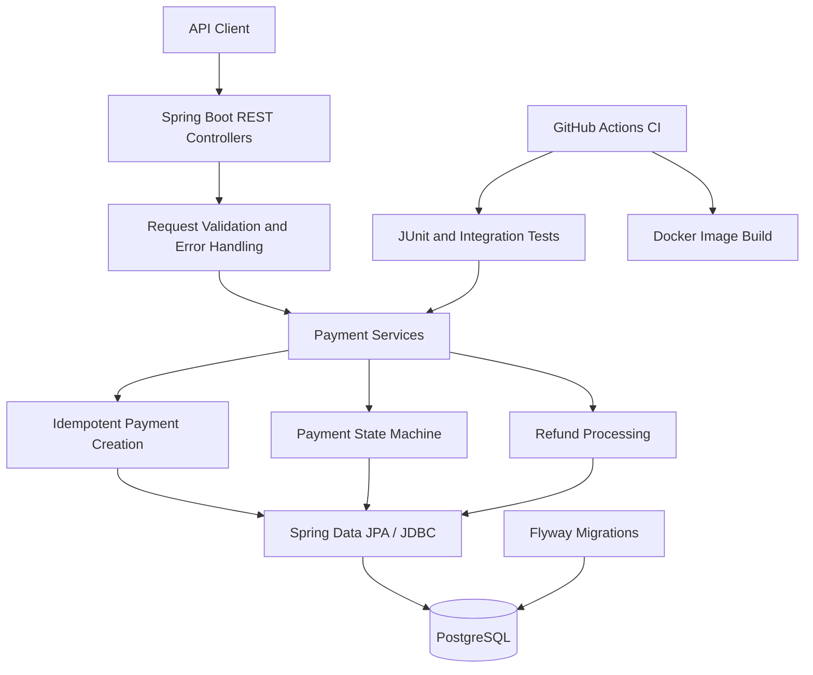
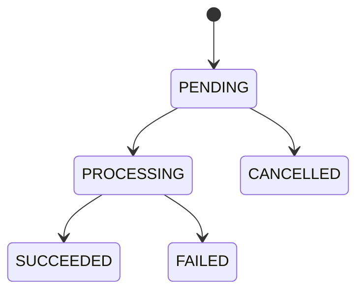
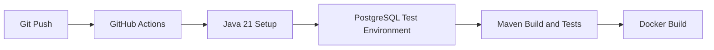

# FundFlow

### Reliable Payment Processing API | Java · Spring Boot · PostgreSQL

**A backend engineering project exploring payment reliability, idempotency, transactional consistency, and concurrency-safe operations.**

[](https://openjdk.org/)
[](https://spring.io/projects/spring-boot)
[](https://www.postgresql.org/)
[](https://www.docker.com/)
[](https://github.com/Rajkumar0863/FundFlow/actions/workflows/ci.yml)

---

## Overview

Payment systems must remain consistent even when clients retry requests, network connections fail, or multiple operations occur simultaneously.

A payment API that merely creates database records is insufficient. Reliable payment processing requires explicit handling of duplicate requests, state transitions, database constraints, transaction boundaries, and recoverable errors.

**FundFlow** was developed to explore these engineering challenges through a RESTful payment-processing backend.

The system supports payment creation, idempotency, lifecycle management, audit history, and refunds, backed by PostgreSQL and automated integration tests.

> **Project scope:** FundFlow is an educational backend system. It does not transfer real funds, process card details, or connect to banking networks.

## Key Capabilities

| Capability | Implementation |
|---|---|
| Payment creation | RESTful API with PostgreSQL persistence |
| Idempotent requests | Client-supplied `Idempotency-Key` |
| Duplicate prevention | Unique database constraints and transaction handling |
| Conflict detection | HTTP `409` for incompatible idempotency-key reuse |
| Payment lifecycle | Explicit state transitions |
| Audit history | Database-backed payment status history |
| Refund processing | Refund creation and retrieval |
| Refund idempotency | Retry-safe refund requests |
| Concurrency protection | Database-backed coordination of competing operations |
| API errors | Structured HTTP error responses |
| API documentation | OpenAPI 3 and Swagger UI |
| Automated testing | JUnit 5 and Spring Boot integration tests |
| CI/CD | GitHub Actions test and Docker build jobs |
| Containerization | Multi-stage Docker build |

## System Architecture



### Technology Stack

**Backend:** Java 21, Spring Boot 4, Spring MVC, Spring Data JPA, Hibernate

**Database:** PostgreSQL, Flyway

**Testing:** JUnit 5, Mockito, Spring Boot Test, MockMvc

**Build and delivery:** Maven, Docker, GitHub Actions

**Documentation:** OpenAPI 3, Swagger UI

---

## Engineering Deep Dive

### 1. Payment Idempotency

Network failures can leave clients uncertain whether a payment request succeeded. Retrying the request must not create an unintended duplicate payment.

FundFlow supports an optional `Idempotency-Key` request header.

| Request scenario | Expected response |
|---|---|
| New key and valid payment | `201 Created` |
| Existing key with matching payload | `200 OK` — original payment |
| Existing key with different payload | `409 Conflict` |
| Request without a key | `201 Created` — legacy behaviour |

**Example**

```http
POST /api/v1/payments
Content-Type: application/json
Idempotency-Key: order-2026-001

{
  "amount": 149.99,
  "currency": "EUR"
}
```

Submitting the same key and matching payload again returns the existing payment instead of creating a second record.

#### Why database constraints matter

Checking for an existing key before inserting is not sufficient on its own. Two concurrent requests can both observe that a key is absent.

FundFlow uses PostgreSQL uniqueness enforcement alongside transactional handling to protect the persisted payment record.

The key engineering principle is:

**Correctness must be enforced at the persistence boundary, not only through application-level checks.**

### 2. Payment State Machine

Payments follow an explicit lifecycle rather than allowing arbitrary status changes.



The API validates requested transitions and rejects invalid lifecycle operations.

Payment status history is persisted for auditability.

**Example**

```http
PATCH /api/v1/payments/{id}/status
Content-Type: application/json

{
  "status": "PROCESSING"
}
```

The state-machine design separates valid business operations from arbitrary database updates.

### 3. Refund Processing

Refund operations introduce additional consistency requirements: a payment must be eligible for refunding, repeated requests must not create unintended duplicates, and concurrent operations must respect the payment's refundable balance.

FundFlow implements refund creation and retrieval with idempotency and database-backed concurrency protection.

```http
POST /api/v1/payments/{paymentId}/refunds
Content-Type: application/json
Idempotency-Key: refund-order-001

{
  "amount": 49.99
}
```

The refund service coordinates refund requests against the associated payment.

### 4. API Error Handling

FundFlow returns meaningful HTTP status codes for supported error conditions.

| Status | Meaning |
|---|---|
| `200 OK` | Successful retrieval or idempotent replay |
| `201 Created` | New resource created |
| `400 Bad Request` | Invalid request data |
| `404 Not Found` | Requested resource does not exist |
| `409 Conflict` | Idempotency conflict or invalid business-state operation |

For idempotency conflicts, the API uses a structured error response so clients can distinguish business conflicts from unexpected failures.

### 5. Database Schema Evolution

Database changes are managed through Flyway rather than relying on Hibernate to recreate tables.

| Migration | Purpose |
|---|---|
| `V1` | Initial payment persistence schema |
| `V2` | Payment idempotency support |
| `V3` | Payment status history |
| `V4` | Refund persistence |

Hibernate schema validation is enabled to detect mismatches between entity mappings and the database schema.

---

## REST API Reference

| Method | Endpoint | Operation |
|---|---|---|
| `POST` | `/api/v1/payments` | Create a payment |
| `GET` | `/api/v1/payments` | List payments |
| `GET` | `/api/v1/payments/{id}` | Retrieve a payment |
| `PATCH` | `/api/v1/payments/{id}/status` | Transition payment status |
| `POST` | `/api/v1/payments/{paymentId}/refunds` | Create a refund |
| `GET` | `/api/v1/payments/{paymentId}/refunds` | List refunds |
| `GET` | `/api/v1/health` | Service health endpoint |

### Interactive Documentation

With the backend running:

**Swagger UI**

`http://localhost:8080/swagger-ui/index.html`

**OpenAPI Specification**

`http://localhost:8080/v3/api-docs`

---

## Getting Started

### Prerequisites

- Java 21
- Maven 3.9+
- Docker Desktop
- Git

### 1. Clone the repository

```bash
git clone https://github.com/Rajkumar0863/FundFlow.git
cd FundFlow
```

### 2. Start PostgreSQL

```bash
docker compose up -d
```

The local development configuration uses PostgreSQL on port `5433`.

### 3. Configure the database

The default local development configuration expects:

```properties
spring.datasource.url=jdbc:postgresql://localhost:5433/fundflow
spring.datasource.username=${DB_USERNAME:fundflow}
spring.datasource.password=${DB_PASSWORD:fundflow_dev}
```

Set `DB_USERNAME` and `DB_PASSWORD` as environment variables when using credentials other than the local development defaults.

### 4. Start the application

```bash
cd backend
mvn spring-boot:run
```

The API is available at:

`http://localhost:8080`

### 5. Run automated tests

```bash
mvn clean verify
```

The integration tests require the dedicated PostgreSQL database `fundflow_test`.

Do not run the integration suite against a database containing important data: the tests reset their test fixtures.

---

## Testing and Quality Assurance

FundFlow combines unit testing with PostgreSQL-backed integration testing.

### Tested behaviours

- Valid and invalid payment creation
- Payment retrieval and listing
- Idempotent payment retries
- Idempotency-key conflicts
- Payment lifecycle transitions
- Invalid transition rejection
- Refund creation and retrieval
- Refund consistency rules
- API response behaviour

**Latest verified local build**

| Metric | Result |
|---|---|
| Tests executed | 31 |
| Failures | 0 |
| Errors | 0 |
| Skipped | 0 |
| Maven build | Success |

These figures represent the verified build at the time of documentation, not a permanent guarantee for future commits.

## Continuous Integration

GitHub Actions runs the backend test suite against a PostgreSQL test environment and builds the application's Docker image.



The workflow includes separate **build-and-test** and **docker-build** jobs.

[View GitHub Actions workflow](https://github.com/Rajkumar0863/FundFlow/actions/workflows/ci.yml)

## Repository Structure

```text
FundFlow/
├── .github/
│   └── workflows/
│       └── ci.yml
├── backend/
│   ├── Dockerfile
│   ├── pom.xml
│   └── src/
│       ├── main/
│       │   ├── java/com/fundflow/
│       │   │   ├── controller/
│       │   │   ├── entity/
│       │   │   ├── repository/
│       │   │   └── service/
│       │   └── resources/
│       │       └── db/migration/
│       └── test/
│           ├── java/com/fundflow/
│           └── resources/
├── compose.yaml
└── README.md
```

## Design Decisions

| Decision | Reason |
|---|---|
| PostgreSQL unique constraints | Protect against duplicate persisted operations |
| Explicit state machine | Prevent invalid payment lifecycle transitions |
| Transactional service boundaries | Keep related database operations consistent |
| Flyway migrations | Make schema evolution repeatable |
| Dedicated test database | Separate integration tests from development data |
| Structured API errors | Improve client-side failure handling |
| GitHub Actions | Detect regressions on pushed changes |
| Docker multi-stage build | Package the backend in a reproducible container image |

## Limitations

FundFlow intentionally focuses on backend payment reliability.

It is **not** a live financial platform and does not currently provide:

- Real card processing or bank integrations
- Authentication and authorization for production users
- PCI DSS-compliant card-data handling
- Production deployment or availability guarantees
- Real payment settlement and reconciliation

These limitations distinguish the implemented portfolio system from a production payment processor.

## What I Learned

Building FundFlow reinforced several important backend engineering principles:

**Idempotency is a correctness requirement.** Retried requests must be evaluated against persisted state, not merely handled as repeated HTTP calls.

**Concurrency changes the design.** Application-level validation alone cannot guarantee correctness when multiple requests execute simultaneously.

**State transitions are business rules.** Explicit lifecycle validation makes payment behaviour easier to reason about and test.

**Database migrations are part of software engineering.** Schema changes need versioning and repeatable execution.

**A successful local build is not enough.** Automated tests and CI provide independent checks against regressions.

---

## Author

**Rajkumar Vijayan**

MSc Software Development — University of Limerick

[GitHub](https://github.com/Rajkumar0863) · [LinkedIn](https://www.linkedin.com/in/rajkumar-vijayan-0135a8338/) · [Portfolio](https://rajkumar0863.github.io)

---

*FundFlow — Engineering reliable payment operations, one transaction at a time.*